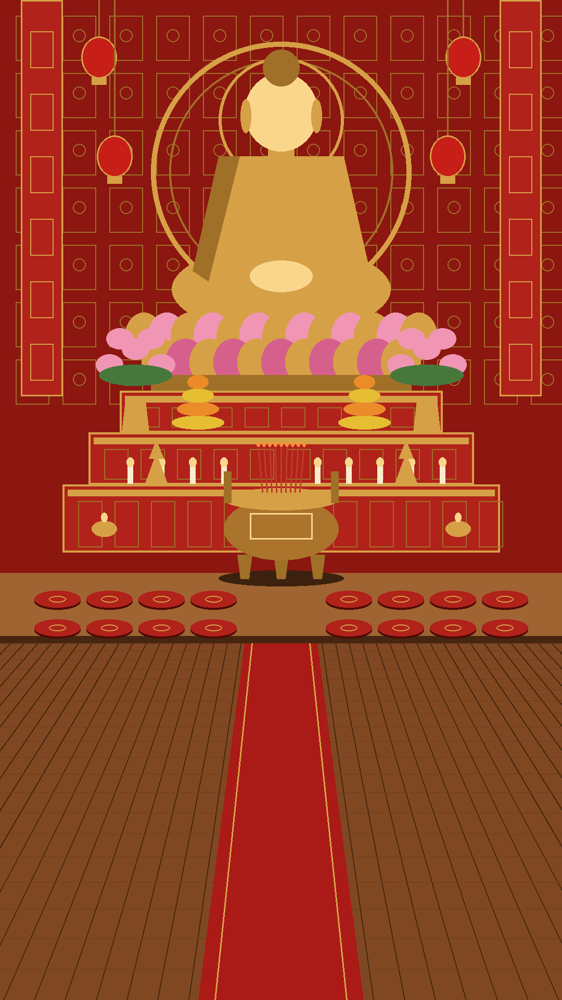

# Asset chùa ảo: prompt gen bằng GPT (ảnh nét)

> Nhân vật Phật tử (một người dùng chung cho cả đám đông): dùng brief cho tác nhân Flow trong [FLOW-BRIEF.md](FLOW-BRIEF.md). File này giữ prompt lẻ các món khác, chỉ gen khi cần.

Nền chánh điện đã có: `assets/bg-key.jpg` (gen bằng GPT). **Không làm video nền**: Flow làm mờ ảnh, code tự làm cảnh "sống" (khói, nến, ánh sáng, người di chuyển).

```
Lớp 4  HUD: khung bảng, icon ô quà, tờ quẻ                    ← ảnh khung + code
Lớp 3  Hiệu ứng: khói, hào quang, tia sáng, cánh sen, lấp lánh ← ảnh hiệu ứng, code điều khiển
Lớp 2  Phật tử (nhiều tư thế), mõ, ống xăm, đèn hoa đăng       ← PNG nền trong suốt, code điều khiển
Lớp 1  Nền chánh điện bg-key.jpg                              ← đã có
```

## Quy tắc chung

- Gen bằng **GPT (ChatGPT / GPT Image)**, chọn chất lượng cao.
- **Người và đạo cụ**: xin rõ *"transparent background PNG"*. Nếu GPT trả nền trắng thì tách nền sau.
- **Hiệu ứng ánh sáng, khói**: nền **đen tuyệt đối**. `pnpm assets:alpha` của kit chuyển phần đen thành trong suốt, giữ độ mờ tự nhiên của khói.
- Mọi ảnh đều **cùng vibe với nền**. Kéo `assets/bg-key.jpg` vào làm ảnh tham chiếu và nói *"match the lighting and colors of this temple image"*.
- Gen xong thả vào `themes/chua/assets/raw/`, đặt đúng tên ở cột **File**, rồi cắt, tách nền bằng công cụ của kit và khai báo trong `theme.json`.

Khối **STYLE** dán vào cuối mọi prompt người và đạo cụ:

```
Style: photorealistic, sharp and clean, matching a bright Vietnamese Buddhist temple hall with warm even indoor lighting (about 3000K); palette of deep lacquer red, burnished gold, warm teak brown, soft cream, muted grey-blue robes. No glow, no haze, no shadow on the background, no text, no watermark.
```

---

## 0. Nền bản 2: tượng to, bàn thờ đầy lễ vật, lư hương chính giữa → `bg-key.png`

Bố cục theo tầng từ trên xuống, máy đặt gần bàn thờ hơn bản 1 (khung 9:16):

| Vùng (tính từ trên) | Có gì |
|---|---|
| 0–38% | Tượng Phật A Di Đà **rất to, đặt cao**, toà sen cao, hào quang khắc vàng |
| 38–55% | Bàn thờ nhiều tầng đầy lễ vật: sen, tháp trái cây, nến, đèn dầu |
| 50–58% | **Lư hương đồng lớn ở chính giữa** (khói code tự làm) |
| 57–64% | Bục gỗ thấp: **2 hàng nệm đỏ, mỗi hàng 8 cái** (4 trái, 4 phải, chừa giữa) = 16 ghế danh dự |
| 64–100% | Sàn gỗ trống + thảm đỏ hoa văn giữa lối (code đặt đám đông) |

```
Vertical 9:16 photorealistic interior of a grand Vietnamese Buddhist temple main hall, perfectly symmetrical, straight-on view down the center aisle. The camera is close to the altar at about 3 meters height, looking straight ahead, so the statue is large and high in the frame and the floor in front is visible.
Top 38% of the image: a very large golden Amitabha Buddha seated in meditation on a tall golden-and-pink lotus throne, placed high up, centered, filling much of the width, with an ornate carved golden halo behind the head and a richly carved red-and-gold lacquered altar wall with golden dragons and clouds, red silk banners and red lanterns hanging on both sides.
From 38% to 55%: a grand multi-tier red-and-gold lacquered altar full of offerings: tall vases of pink lotus flowers, fruit towers, rows of lit candles, golden oil lamps and small golden pagodas, symmetrical on both sides.
Exactly in the center in front of the altar, from 50% to 58%: one large ornate bronze tripod incense censer with a few lit incense sticks.
From 57% to 64%: a low wooden platform step across the width with two rows of round red embroidered meditation cushions, 8 per row (4 on the left, 4 on the right, an empty gap in the center).
Bottom 36%: polished warm teak wooden floor, completely empty, with a red patterned carpet runner from the bottom edge straight up the center to the platform.
No people anywhere.
```
→ dán **STYLE** vào cuối. Gen xong lưu `raw/bg-key.png`, rồi đo lại toạ độ trong `scene.json` (mở `/overlay?scene`).

**Cách chắc ăn nhất:** đưa GPT **bản phác bố cục** `assets/ref/layout-guide.png` (code vẽ, sạch, không chữ) kèm ảnh nền bản 1 `assets/bg-key.jpg` làm tham chiếu màu, rồi dán:



```
Turn the first image (a flat layout sketch) into a photorealistic photograph of a grand Vietnamese Buddhist temple main hall. Keep EXACTLY the same composition, sizes and positions: the very large golden Buddha high at the top with the carved golden halo, the red banners and lanterns on both sides, the three-tier altar full of offerings, the one large bronze tripod incense censer in the center, the low platform with two rows of 8 red cushions (4 left, 4 right), the red carpet and the empty wooden floor at the bottom. Replace the flat shapes with rich real materials and fine carved detail. Use the colors and lighting of the second image. No people.
```
→ dán **STYLE** vào cuối.

---

## 1. Phật tử: một tờ hoạt hình 16:9 cho mỗi người (quan trọng nhất)

Giống tờ hoạt hình làm phim: **một ảnh 16:9 chứa đủ mọi động tác của một người**, chia lưới **6 cột × 5 hàng = 30 khung**. Mỗi hàng là một động tác, đọc từ trái sang phải là các khung nối tiếp nhau. Công cụ cắt tờ của kit (`pnpm assets:cut`) tách nền, cắt 30 khung và xếp thành tờ cho code.

Danh sách động tác lấy theo những gì code chùa đang dùng: vào chùa đi lên lối giữa rồi rẽ về chỗ, ngồi chờ, lạy, lên bàn thờ dâng hương, xin xăm, về chỗ, rời chùa.

| Hàng | Động tác | 6 khung (trái → phải) | Code dùng khi |
|---|---|---|---|
| 1 | **Đi vào** (thấy lưng) | chân trái chạm đất · hạ người · chân đưa qua · chân phải chạm đất · hạ người · chân đưa qua | vào chùa, lên bàn thờ |
| 2 | **Đi ra** (thấy mặt, mắt nhìn xuống, chắp tay) | 6 khung bước như hàng 1 | về chỗ sau khi dâng lễ, rời chùa |
| 3 | **Đi ngang** (nghiêng, quay sang phải) | 6 khung bước như hàng 1 | rẽ vào hàng ghế (code tự lật khi đi sang trái) |
| 4 | **Quỳ và lạy** (thấy lưng) | quỳ ngồi trên gót, chắp tay (dáng chờ) · chắp tay đưa lên trán · cúi nửa người · hai tay chống sàn · lạy sát đất · quỳ chắp tay, đầu hơi cúi | ngồi chờ, lạy 3 lạy, gật đầu khi chat |
| 5 | **Đứng, ngồi xuống, dâng hương, xin xăm** (thấy lưng) | đứng chắp tay · đang quỳ xuống (một gối chạm đất) · đứng cầm 3 nén nhang trước ngực · nhang giơ lên trán, vái · quỳ ôm ống xăm trước ngực · quỳ, ống xăm nghiêng đang lắc, một que nhô ra | đứng trước bàn thờ, dâng hương, xin xăm |

Lưu ý khi gen:
- **Nền xanh lá trơn** (công cụ tự tách). Áo lam xám và tóc đen không trùng màu xanh nên tách sạch.
- **Không vẽ bồ đoàn, sàn, bóng đổ** dưới người: code tự vẽ nệm ở từng chỗ ngồi, lúc đứng dậy đi thì nệm vẫn ở lại.
- Gen **độ phân giải cao nhất** (2K / 4K). 16:9 thì dùng Gemini / Flow; GPT chỉ có 3:2 cũng được, công cụ chỉ cần đúng lưới 6 × 5.
- AI hay vẽ lệch lưới khi nhiều khung. Nếu hỏng, gen 2 ảnh: hàng 1–3 (đi) và hàng 4–5 (tại chỗ), rồi ghép lại.
- Gen người đầu tiên xong, **trong cùng cuộc chat** gõ *"Same sheet, same layout and style, but the person is [nhân vật khác]"* để cả bộ cùng một nét.

→ `raw/devotee-<n>.png`

```
A 16:9 animation model sheet (sprite sheet) for a 2.5D live-stream game, on a perfectly flat pure chroma-key green background (#00FF00) everywhere: no gradient, no floor, no cushion, no shadow, no grid lines, no labels, no numbers, no text.
It shows exactly 30 drawings of the SAME Vietnamese Buddhist lay devotee, [nhân vật], wearing a traditional muted grey-blue lay robe (áo tràng lam), arranged in a strict invisible grid of 6 columns and 5 rows. Each drawing is centered in its own cell, never touching its neighbours, with the feet or knees resting on the bottom line of the cell. All 30 drawings use the same scale (a standing figure fills about 85% of the cell height) and the same camera, slightly above the person looking about 30 degrees downward. Identical face, hair, robe and body proportions in every cell.
Row 1, walking away from the camera (seen from behind), a smooth 6-frame walk cycle, palms pressed together in front of the chest: left foot contact, down, passing, right foot contact, down, passing.
Row 2, walking toward the camera (seen from the front, calm face, eyes lowered), the same 6-frame walk cycle, palms together.
Row 3, walking to the right (seen from the side), the same 6-frame walk cycle, palms together.
Row 4, seen from behind facing a Buddha statue far ahead, a bowing sequence: 1) kneeling and sitting back on the heels, back straight, palms together at the chest; 2) joined palms raised to the forehead; 3) bowing halfway forward; 4) leaning forward with both hands flat on the floor; 5) full prostration, forehead and forearms on the floor; 6) kneeling upright with palms together and the head slightly lowered.
Row 5, seen from behind: 1) standing upright, palms together; 2) halfway kneeling down, one knee touching the floor; 3) standing, holding three lit incense sticks with both hands in front of the chest; 4) raising the incense to the forehead and bowing slightly; 5) kneeling, holding a red bamboo fortune-stick cup against the chest; 6) kneeling, the cup tilted forward mid-shake with one stick sliding out.
Full body in every cell, nothing cut off.
```
→ dán **STYLE** vào cuối.

Nhân vật (thay vào *[nhân vật]*), ưu tiên 1, 2, 5 trước. Code tự lật trái phải và đổi tông áo nhẹ, nên 3 người đã đủ thành đám đông:

1. `an elderly woman with grey hair in a neat low bun`
2. `a middle-aged woman with black hair tied in a bun`
3. `a young woman with long black hair tied in a low ponytail`
4. `an elderly man with short white hair`
5. `a middle-aged man with short black hair`
6. `a young man with short black hair`

Sư, ni, chú tiểu: dùng cùng prompt, đổi trang phục thành *"a Vietnamese Buddhist monk with a shaved head in a brown robe"* (ni: *"a Vietnamese Buddhist nun with a shaved head in a grey robe"*, tiểu: *"a young novice boy with a shaved head in a light brown robe"*).

**Sau khi gen**, chạy trong thư mục kit `../tiktok-live-kit`:

```
pnpm assets:cut ../tiktok-live-pgd/themes/chua/assets/raw/devotee-1.png ../tiktok-live-pgd/themes/chua/assets/chars/devotee-1.png --auto
```

Công cụ in sẵn đoạn khai báo nhân vật cho `theme.json` (`walkUp`, `walkDown`, `walkSide`, `poses`) và ghi `devotee-1-preview.png` có đánh số khung để soát. Khi cả bộ đã thay, động tác trong `"animations"` đổi sang khung thật:

```json
"bow":   { "frames": ["idle", "handsUp", "bowHalf", "bowHands", "bowFull", "bowFull", "bowHalf", "handsUp", "idle"], "ms": 2400 },
"offer": { "frames": ["stand", "incense", "offer", "offer", "incense", "stand"], "ms": 1800 },
"nod":   { "frames": ["idle", "idle2", "idle"], "ms": 900 },
"xam":   { "frames": ["xam", "xam2", "xam", "xam2"], "ms": 520 },
"sit":   { "frames": ["stand", "sitDown", "idle"], "ms": 700 }
```

---

## 2. Hiệu ứng (nền đen, chuyển thành trong suốt bằng `pnpm assets:alpha`)

Thêm vào cuối mỗi prompt: `On a pure black background, nothing else in the image, no text.`

| File | Tỉ lệ | Dùng khi | Prompt |
|---|---|---|---|
| `fx-smoke.png` | 3:2 | khói hương liên tục, dâng hương | `Four separate thin wisps of soft white incense smoke side by side, each rising and curling upward from a narrow base, realistic, delicate, not touching each other` |
| `fx-halo.png` | 1:1 | đại lễ, quà lớn | `A radiant golden Buddhist halo: concentric glowing golden rings with fine radiating rays and a subtle lotus pattern, centered, symmetrical` |
| `fx-rays.png` | 9:16 | ban phước, đạt mục tiêu | `Soft golden god rays streaming down from the top center in a fan shape, with tiny floating golden dust particles` |
| `fx-sparkle.png` | 1:1 | lễ Phật, lên nệm, lên danh hiệu | `Six separate small golden sparkles and glowing star bursts of different sizes, scattered with space between them` |

## 3. Hoa sen, cánh sen, đèn (nền trong suốt)

Dán **STYLE** vào cuối.

| File | Tỉ lệ | Dùng khi | Prompt |
|---|---|---|---|
| `lotus.png` | 1:1 | sen bay lên bàn thờ | `A single fully bloomed pink lotus flower with a golden center, seen from slightly above, isolated on a transparent background` |
| `petals.png` | 3:2 | mưa cánh sen | `Six separate soft pink lotus petals in different angles and curls, scattered with space between them, on a transparent background` |
| `den-sen.png` | 1:1 | đèn hoa đăng người dâng | `A small lotus-shaped oil lamp with pink and gold petals and a small warm flame in the center, isolated on a transparent background` |

## 4. Đạo cụ tương tác (nền trong suốt)

Dán **STYLE** vào cuối.

| File | Tỉ lệ | Dùng khi | Prompt |
|---|---|---|---|
| `mo.png` | 1:1 | **gõ mõ công đức** (thả tim) | `A traditional Vietnamese Buddhist wooden fish drum (mõ) carved as a round fish, dark red lacquer with gold details, on a small red embroidered cushion, three-quarter front view, isolated on a transparent background` |
| `mo-dui.png` | 1:1 | dùi gõ mõ | `A single wooden mallet for a Buddhist wooden fish drum with a round padded red cloth head and a dark wooden handle, lying diagonally, isolated on a transparent background` |
| `ong-xam.png` | 2:3 | **xin xăm** | `A traditional bamboo fortune stick cylinder (ống xăm) filled with thin red-tipped bamboo sticks, red lacquer band with gold ornament, front view, isolated on a transparent background` |
| `que-xam.png` | 2:3 | que xăm rơi ra | `A single thin bamboo fortune stick with a red painted tip, vertical, isolated on a transparent background` |

## 5. Giao diện (thay khung vẽ bằng CSS cho sang hơn)

| File | Tỉ lệ | Prompt |
|---|---|---|
| `que-card.png` | 2:3 | `An empty traditional Vietnamese fortune slip of aged handmade dó paper in soft cream, a deep red and gold ornamental border, a small red lotus seal at the top, blank center, flat front view, full frame, no text` |
| `panel.png` | 3:2 | `An empty ornamental frame panel: deep red lacquer with carved gold Buddhist cloud and lotus border, blank dark red center, flat front view, full frame, no text` |
| `icons.png` | 3:2 | `Three separate golden emblem icons in a row on a transparent background: 1) a bundle of three incense sticks, 2) a pair of hands pressed together in prayer, 3) a blooming lotus. Polished gold with red accents, same size, no text` |

---

## Âm thanh

Dùng **file thu âm thật** trong `assets/sfx/`: `chuong-lon.mp3`, `chuong.mp3`, `mo.mp3`, `sen.mp3`. Nhạc nền, tiếng tụng: `.mp3` trong `assets/music/`. Chỉ dùng file miễn phí bản quyền hoặc file bạn có quyền dùng, ghi nguồn vào `CREDITS.md`.

## Thứ tự gen gợi ý

1. **Phật tử** nhân vật 1, 2, 5 (thay hình vẽ phẳng, khác biệt lớn nhất).
2. **`fx-smoke`, `fx-halo`, `lotus`, `petals`** (hiệu ứng quà).
3. **`mo` + `mo-dui`** (gõ mõ công đức), **`ong-xam` + `que-xam` + `que-card`** (xin xăm).
4. **`panel`, `icons`** (giao diện), rồi phần còn lại.

## Công cụ

- `tools/make-layout.py`: vẽ bản phác bố cục chánh điện (nếu cần gen lại nền).
- `pnpm assets:cut` (trong kit): cắt tờ hoạt hình nhân vật (lưới 6 × 5, nền xanh lá) thành tờ khung cho code, kèm ảnh soát có đánh số.
- Ảnh tham chiếu: `assets/ref/`.
